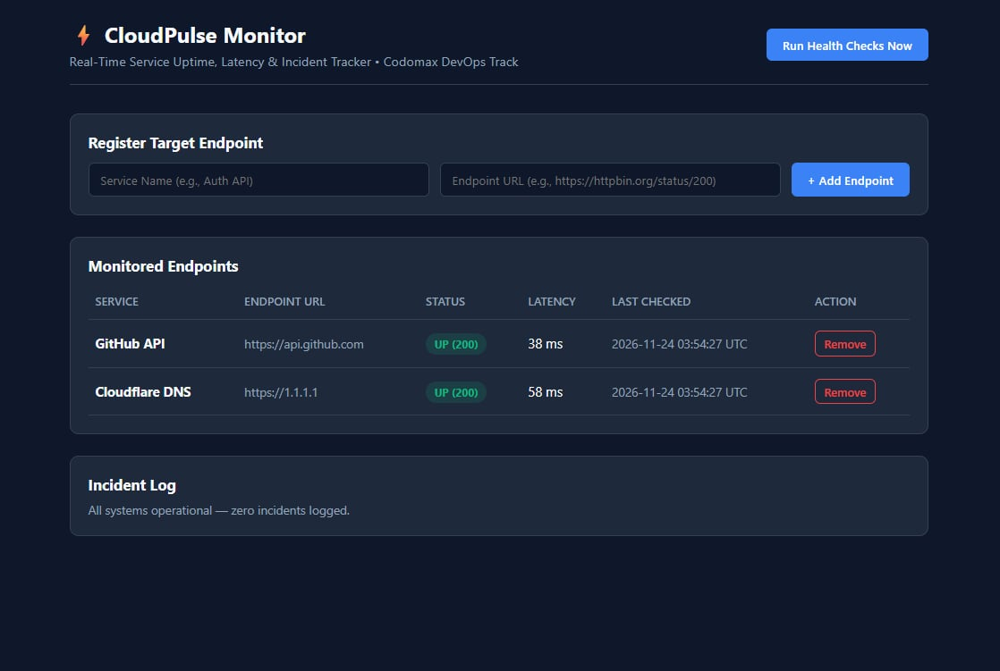
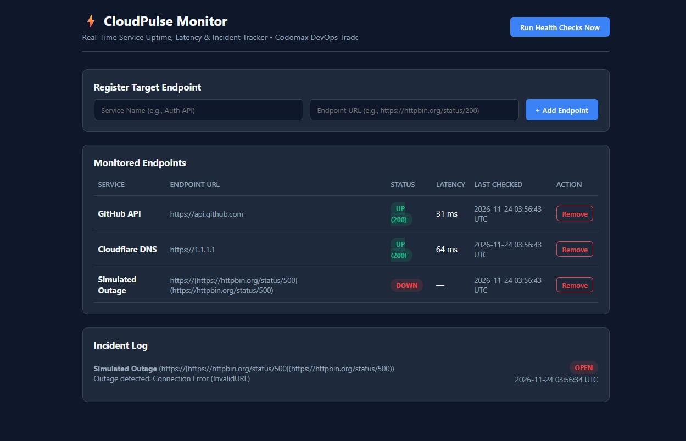
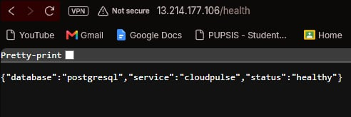
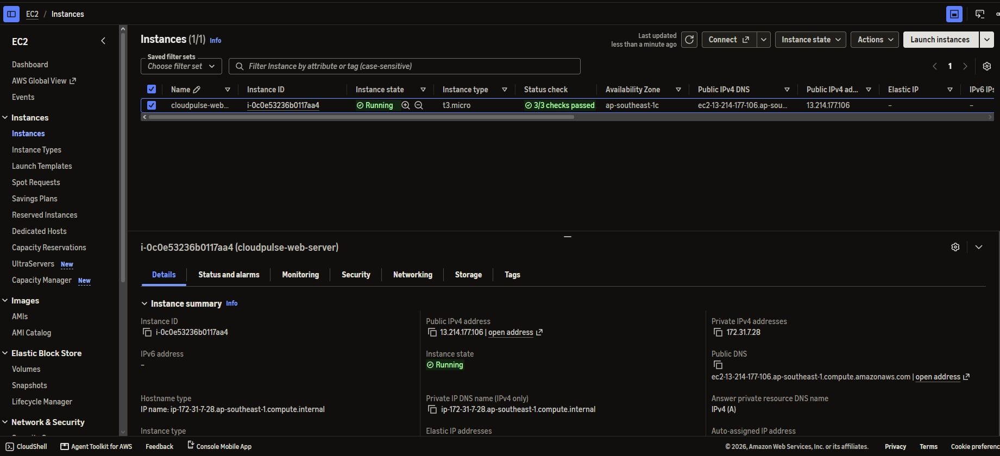
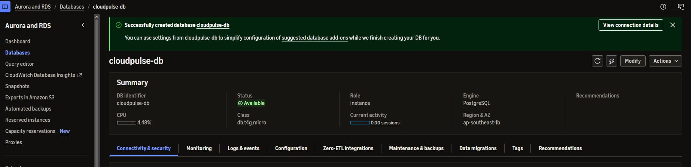

# CloudPulse — Service Uptime & Incident Monitor

CloudPulse is a full-stack service health monitoring and incident-tracking web application deployed on **AWS (ap-southeast-1)** using a decoupled compute and database architecture. It performs live HTTP health checks against target endpoints, records response latency in milliseconds, and automatically logs downtime incidents to a managed **PostgreSQL** database.

---

## Architecture Overview

```text
[ Public Internet ]
        │  HTTP (Port 80)
        ▼
┌───────────────────────────────────────────────────┐
│  AWS EC2 (Ubuntu 26.04 • t3.micro)                │
│                                                   │
│   Nginx (Reverse Proxy :80)                       │
│        │                                          │
│        ▼                                          │
│   Gunicorn WSGI Server (127.0.0.1:8000)           │
│        ▲                                          │
│        └── Managed by systemd (cloudpulse.service)│
└───────────────────────┬───────────────────────────┘
                        │  PostgreSQL (Port 5432)
                        │  Restricted via VPC Security Group
                        ▼
┌───────────────────────────────────────────────────┐
│  AWS RDS (PostgreSQL • db.t4g.micro)              │
│  Private Database Tier (Public Access: Disabled)  │
└───────────────────────────────────────────────────┘
```

### Tech Stack
* **Cloud Infrastructure:** AWS EC2 (`t3.micro`), AWS RDS for PostgreSQL (`db.t4g.micro`), AWS VPC Security Groups
* **Operating System & Web Server:** Ubuntu 26.04 LTS, Nginx (Reverse Proxy), `systemd` (Process Supervision)
* **Backend & WSGI:** Python 3.14, Flask, Flask-SQLAlchemy (SQLAlchemy 2.1), Gunicorn, `psycopg` (v3)

---

## Key Cloud & DevOps Implementations

1. **Network Isolation & Least-Privilege Security Groups:**
   * **Web Tier Security Group:** Exposes only SSH (`22`) for administration and HTTP (`80`) for public web traffic; Gunicorn binds strictly to `127.0.0.1:8000`.
   * **Database Tier Security Group:** Public accessibility is disabled. Inbound traffic on port `5432` is restricted exclusively to the EC2 instance's Security Group ID rather than IP-based CIDR blocks.
2. **Production Process Management (`systemd`):**
   * Configured `/etc/systemd/system/cloudpulse.service` with `Restart=always` and `EnvironmentFile` injection so the application survives SSH disconnects and automatically recovers from crashes or reboots.
3. **Reverse Proxy Configuration (`Nginx`):**
   * Configured Nginx to forward incoming port `80` requests to Gunicorn on `127.0.0.1:8000` with standard `X-Real-IP` and `X-Forwarded-*` headers.
4. **Zero-Cost Resource Lifecycle Management:**
   * Provisioned, verified, documented, and cleanly decommissioned both EC2 and RDS instances (without retained snapshots or automated backup storage) immediately after validation.

---

## Deployment Guide (Ubuntu 26.04 on EC2)

### 1. System Dependencies & Application Setup
```bash
sudo apt update && sudo apt install -y python3-venv python3-pip git nginx
git clone [https://github.com/bryankyle113/codomax-cloud-devops-internship.git](https://github.com/bryankyle113/codomax-cloud-devops-internship.git)
cd codomax-cloud-devops-internship/module-03-cloud-web-app

python3 -m venv venv
source venv/bin/activate
pip install -r requirements.txt
```

### 2. Environment Configuration
Create a `.env` file with the private RDS endpoint connection string:
```bash
cat << 'EOF' > .env
DATABASE_URL=postgresql://postgres:<RDS_PASSWORD>@<RDS_ENDPOINT>:5432/cloudpulse
EOF
```

### 3. `systemd` Service Unit
```bash
sudo tee /etc/systemd/system/cloudpulse.service > /dev/null << 'EOF'
[Unit]
Description=Gunicorn instance to serve CloudPulse
After=network.target

[Service]
User=ubuntu
Group=www-data
WorkingDirectory=/home/ubuntu/codomax-cloud-devops-internship/module-03-cloud-web-app
Environment="PATH=/home/ubuntu/codomax-cloud-devops-internship/module-03-cloud-web-app/venv/bin"
EnvironmentFile=/home/ubuntu/codomax-cloud-devops-internship/module-03-cloud-web-app/.env
ExecStart=/home/ubuntu/codomax-cloud-devops-internship/module-03-cloud-web-app/venv/bin/gunicorn --workers 2 --bind 127.0.0.1:8000 app:app
Restart=always

[Install]
WantedBy=multi-user.target
EOF

sudo systemctl daemon-reload
sudo systemctl enable --now cloudpulse
```

### 4. Nginx Reverse Proxy
```bash
sudo tee /etc/nginx/sites-available/cloudpulse > /dev/null << 'EOF'
server {
    listen 80;
    server_name _;

    location / {
        proxy_pass [http://127.0.0.1:8000](http://127.0.0.1:8000);
        proxy_set_header Host $host;
        proxy_set_header X-Real-IP $remote_addr;
        proxy_set_header X-Forwarded-For $proxy_add_x_forwarded_for;
        proxy_set_header X-Forwarded-Proto $scheme;
    }
}
EOF

sudo ln -sf /etc/nginx/sites-available/cloudpulse /etc/nginx/sites-enabled/
sudo rm -f /etc/nginx/sites-enabled/default
sudo nginx -t && sudo systemctl restart nginx
```

---

## Troubleshooting Log

* **Issue:** Gunicorn workers failed to boot on Ubuntu 26.04 (Python 3.14) with `ModuleNotFoundError: No module named 'psycopg'` despite `psycopg2-binary` being installed.
* **Root Cause:** SQLAlchemy 2.1 defaults generic `postgresql://` connection URIs to the modern **psycopg (v3)** dialect rather than legacy `psycopg2`.
* **Resolution:** Installed `psycopg[binary]` inside the virtual environment and added it to `requirements.txt` for compatibility with Python 3.14 and SQLAlchemy 2.1.

---

## Proof of Deployment

### Live Dashboard & Latency Checks


### Incident Logging Verification


### Database Health Endpoint (`/health`)


### AWS EC2 & RDS Console Provisioning

